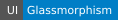
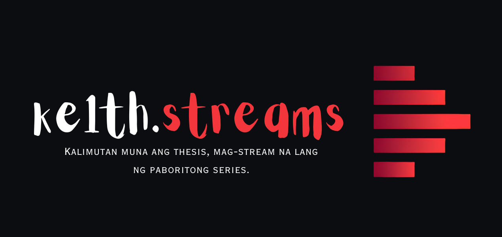

<div align="center">
  
  <h1>ke1th.streams</h1>
  <p>A sleek, high-performance streaming interface built with the TMDB API.</p>

  <a href="https://stream.ke1th.dev/"><strong>Live Demo</strong></a>

  <br><br>

  
  
  
  <br><br>
  
  
</div>

<br>

## Overview

Logos, UI images, fonts, and bundled catalog artwork are local. See [local image storage and cache setup](assets/imgs/README.md) for XAMPP and Cloudflare Pages deployment details.

**ke1th.streams** is a modern, highly responsive streaming UI inspired by premium platforms like Netflix and Disney+. It features a multi-server streaming player, dynamic content discovery via the TMDB API, and a polished aesthetic focused strictly on user experience.

Playback is provided by third-party players. UI images, verified channel logos, and bundled catalog artwork are stored in this project. User preferences (like "Watch Later" lists and "Watch Progress") are stored locally on your own device.

---

## Live

Experience the platform live at: **[stream.ke1th.dev](https://stream.ke1th.dev/)**

---

## Features

### Content Discovery
- **Dynamic Content Rails** – Smooth horizontal scrolling for Top 10 Today, Trending, Top Rated, and genre-based sections.
- **Platform Dropdowns** – Browse content exclusive to top streaming platforms (Netflix, Prime Video, Disney+, Max, Apple TV+, etc.) with official TMDB logos.
- **Hero Spotlights** – Auto-rotating cinematic hero banners with backdrop images and metadata.

### Media Detail Page
- **Background Trailer** – Auto-playing YouTube trailer in the hero section. Fully cropped to appear as a cinematic background with no visible YouTube branding.
- **Thumbs Up / Down Rating System** – Rate movies and shows securely. Powered by TMDB Guest Sessions, allowing users to submit ratings entirely anonymously without needing to create or link an account.
- **Cast Grid & Recommendations** – Browse actor cards and seamlessly discover "More Like This".

### Streaming Player
- **Multiple Server Sources** – High-quality streaming servers with a compact dropdown server selector.
- **Auto-Fallback** – Automatically switches to a backup source if a server fails.
- **Ad-Blocker Friendly** – All server ads are blockable with extensions like uBlock Origin or Brave browser. A built-in disclaimer guides users on secure setup.

### User Experience & Security
- **100% Local Storage** – Watch Progress, Search History, and Watch Later lists are tracked securely via `localStorage` on your own device. Your data never touches my servers.
- **Edge Proxy API Security** – All API requests to TMDB are routed securely through a custom Cloudflare Worker proxy, completely hiding the API key from the browser and protecting against scraping.
- **Anonymous Ratings** – The thumbs up/down system uses temporary TMDB guest sessions to protect your privacy.
- **Dark Mode Native** – Deep dark theme optimized for OLED displays with premium glassmorphism effects.

---

## Tech Stack

| Layer | Technology |
|-------|-----------|
| **Frontend** | HTML5, CSS3, Vanilla JavaScript (Zero frameworks) |
| **API Integration** | TMDB API (Metadata, Images, Videos, Providers, Guest Sessions) |
| **Media Delivery**| Third-party iframe embeds |
| **Data Persistence** | `localStorage` (Secure client-side storage) |
| **Hosting & CI/CD** | Cloudflare Pages integrated via GitHub |

---

## Setup Instructions

### XAMPP on Windows

1. Keep this project in `C:\xampp\htdocs\STREAMMOVIES`.
2. Open the XAMPP Control Panel and start **Apache**.
3. Open [http://localhost/STREAMMOVIES/](http://localhost/STREAMMOVIES/) in your browser.

The site uses static HTML, CSS, and JavaScript. Apache serves the files, while
the catalog and video players connect to their existing online services.

Live TV channels are listed in `channels/channels.json`. Compatible HLS sources
load directly. The added BX-TV channels that need browser-compatible delivery
use BX-TV's public HTTPS relay, including its rewritten child playlists and
segments. Their availability depends on those third-party services.

The guide also separates Radio, Anime, Faith & Worship, and Lifestyle & Travel.
Radio uses an audio player with station artwork. Closing or changing a selection
stops the previous audio or video. The desktop and mobile channel lists
scroll independently while a player is open.

The `tzujtv.json` import keeps existing sources, merges duplicate names/URLs,
and adds TV/radio sources that pass playlist and media-sample checks. Individual
on-demand movie records from that import are excluded from the live guide.

Zeno radio entries keep the original station URL so the browser can obtain a
fresh signed redirect when connecting. Do not save the temporary Surfernetwork
URL containing `zt=` as the permanent source. Radio checks use a normal browser
User-Agent; the abbreviated `Mozilla/5.0` identifier can produce a false 401.

The mobile dock uses the official Glisse Tab Bar and Glass components.
The browser-ready bundle is included. If you edit the dock integration,
run `npm ci` followed by `npm run build:glass` to rebuild it.

To run this project locally:

1. Clone the repository to your machine.
2. Open `assets/js/config.js`. You have two options for configuring the TMDB API:
   - **Option A (Quick Start):** Set `BASE_URL` to `https://api.themoviedb.org/3` and paste your TMDB API key into the `API_KEY` variable. *(Note: This exposes your key in the browser)*.
   - **Option B (Secure/Production):** Deploy a Cloudflare Worker as an API proxy. Set your `BASE_URL` to your proxy's URL and leave `API_KEY` empty. See the **Cloudflare Worker Setup** section below for the code and instructions.
3. Open `index.html` in your browser or run a local development server.

```text
STREAMMOVIES/
  assets/
    css/        -- Stylesheets (home.css, media.css)
    js/         -- Application logic (home.js, media.js, tmdb.js, config.js)
    imgs/       -- Favicons and PWA assets
  index.html    -- Home page
  media.html    -- Media detail page
```

### Cloudflare Worker Setup (Optional)

If you want to completely hide your TMDB API key from the browser, you can deploy a Cloudflare Worker proxy in under 2 minutes.

1. Go to your Cloudflare Dashboard -> **Workers & Pages** -> **Create Worker**.
2. Name it (e.g. `tmdb-proxy`) and click **Deploy**.
3. Go to the worker's **Settings** -> **Variables** -> **Environment Variables**.
4. Add a new variable named `TMDB_API_KEY`, paste your TMDB API key as the value, and click **Encrypt** to hide it.
5. Click **Quick Edit** on your worker, paste the following script, and click **Save and Deploy**.

```javascript
export default {
  async fetch(request, env) {
    const url = new URL(request.url);
    
    // Build the TMDB URL (automatically prepending /3/ if missing)
    let path = url.pathname;
    if (!path.startsWith('/3/')) path = '/3' + path;
    const tmdbUrl = new URL(`https://api.themoviedb.org${path}${url.search}`);
    
    // Securely inject the API key
    if (env.TMDB_API_KEY) tmdbUrl.searchParams.set('api_key', env.TMDB_API_KEY);

    let response = await fetch(tmdbUrl);
    
    // Enable CORS and add Cache-Control for speed
    let newResponse = new Response(response.body, response);
    newResponse.headers.set('Access-Control-Allow-Origin', '*');
    newResponse.headers.set('Cache-Control', 'public, max-age=3600');

    return newResponse;
  }
}
```

---

## Legal Disclaimer

**ke1th.streams** links to video playback hosted by third-party services. Site images, fonts, and cached artwork are stored with the application.

<br>

<div align="center">
  <sub>Built for speed. Designed for aesthetics. Secured for privacy.</sub>
</div>
